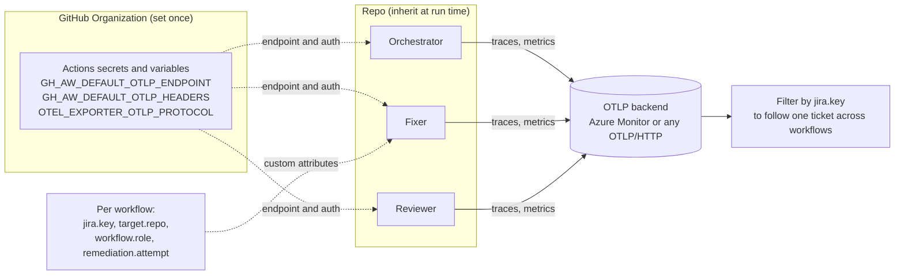

# Automated Vulnerability Remediation Pipeline (CentralRepoOps + OrchestratorOps)

Option C: Hybrid 3-Stage Pipeline (Recommended) (Orchestrator + Fix/Test Worker + Reviewer Worker)	

1. Orchestrator reads Jira & fans out.
2. Remediation Worker loads Triage, Fix, and Test skills in one workspace and opens a Draft PR.
3. Reviewer Worker inspects the PR diff against your Review skill, comments/approves, and marks it ready.	

Pros

• Keeps the Fix ↔ Test loop intact in one warm container
• True independent review (fresh context, read-only code permissions, cannot edit code)
• Clean blast-radius control: Orchestrator only touches Jira; Worker only opens Draft PRs	

Cons
• Slightly more YAML wiring than a single file (3 workflows total instead of 1)


your-central-repo/
├── README.md                                  <-- Architecture guide, diagrams & scenarios
└── .github/
    ├── skills/                                <-- Reusable skills (kept ONLY in Central Repo)
    │   ├── vuln-triage/SKILL.md
    │   ├── vuln-fix/SKILL.md
    │   ├── test-runner/SKILL.md
    │   └── security-review/SKILL.md
    └── workflows/
        ├── jira-orchestrator.md               <-- Batch Jira reader & dispatcher
        ├── fixer-worker.md                    <-- Triage, Fix, Test & Draft PR creator
        └── reviewer-worker.md                 <-- Independent Reviewer (Model B)


This repository hosts the centralized AI agents, reusable remediation skills, and orchestration workflows used to automatically triage, patch, test, review, and raise Pull Requests for vulnerabilities across organization repositories.

Target repositories **do not** store any agent workflows or skill files—everything is governed centrally here.

---

## 1. Architecture Overview

This system combines two GitHub Agentic Workflow (`gh-aw`) patterns:
* **CentralRepoOps:** All `.github/skills/`, workflow definitions, Jira credentials, and cross-repo tokens live in this single control repository.
* **OrchestratorOps:** A lightweight Orchestrator ingests Jira tickets in controlled batches and fans out isolated Fixer and Reviewer workers per repository.

### End-to-End Architecture Diagram

```text
┌──────────────────────────────────────────────────────────────────────────────┐
│                                 JIRA CLOUD                                   │
│  Bulk Scanner / Security Team creates tickets with label: `ai-remediate`     │
└───────────────┬──────────────────────────────────────────────▲───────────────┘
                │ Webhook (`repository_dispatch`)              │ Status & PR
                │ OR Cron Schedule (every 20 mins)             │ Updates
                ▼                                              │
┌──────────────────────────────────────────────────────────────┴───────────────┐
│                         CENTRAL REPOSITORY (Control Plane)                   │
│                                                                              │
│  ┌────────────────────────────────────────────────────────────────────────┐  │
│  │ 1. jira-orchestrator.md (Concurrency Lock: `jira-vuln-orchestrator`)   │  │
│  │    • Queries top 5 `Open` tickets ordered by Priority                  │  │
│  │    • Checks for duplicate PRs (Idempotency)                            │  │
│  │    • Transitions Jira: `Open` ──► `AI In Progress`                     │  │
│  │    • Dispatches up to 5 parallel workers (`max: 5`)                    │  │
│  └────────────┬───────────────────────────────────────────────────────────┘  │
│               │                                                              │
│               ▼ (Parallel across repos; queued per same repo)                │
│  ┌────────────────────────────────────────────────────────────────────────┐  │
│  │ 2. fixer-worker.md [Model A: Claude Sonnet]                            │  │
│  │    • Mounts `.github/skills/` + checks out `target_repo`               │  │
│  │    • Attempt 1: Triage ─► Fix ─► Run Tests ─► Raise DRAFT PR           │  │
│  │    • Attempt 2–3: Read Review Comments ─► Fix ─► Re-Test ─► Push       │  │
│  └────────────┬──────────────────────────────────────────────▲────────────┘  │
│               │ Dispatches with PR details                   │ Bounce back   │
│               ▼                                              │ (attempt < 3) │
│  ┌───────────────────────────────────────────────────────────┴────────────┐  │
│  │ 3. reviewer-worker.md [Model B: GPT-5.2]                               │  │
│  │    • Zero-memory independent security & test audit                     │  │
│  │    • APPROVED ──────────► Marks Draft PR Ready for Human Review        │  │
│  │    • REJECTED (< 3) ────► Posts inline comments & re-triggers Fixer    │  │
│  │    • REJECTED (== 3) ───► Closes Draft PR & escalates Jira to Human    │  │
│  └────────────────────────────────────────────────────────────────────────┘  │
└──────────────────────────────────────────────────────────────────────────────┘
```

---

## 2. How Bulk Requests & Concurrency Are Handled

When a vulnerability scanner imports 50+ Jira tickets at once, uncontrolled triggers would cause GitHub API throttling (`403 Abuse detection`), LLM token quota exhaustion, and Git merge conflicts. This design solves that at three layers:

1. **Orchestrator Mutex Lock (`concurrency: jira-vuln-orchestrator`):**
   Only **one** Orchestrator instance runs at a time. If 50 webhooks arrive simultaneously, GitHub runs the first Orchestrator and collapses/queues the rest—preventing race conditions where two Orchestrators grab the same Jira tickets.
2. **Batch Throttling (`max: 5` + 20-Minute Cron):**
   Each Orchestrator run picks the **top 5 highest-priority** `Open` tickets, locks them in Jira (`AI In Progress`), and dispatches 5 workers. Remaining tickets are drained automatically in waves of 5 every 20 minutes.
3. **Per-Repository Queue (`concurrency: remediation-${target_repo}`):**
   - Tickets targeting **different repositories** (`repo-A`, `repo-B`, `repo-C`) execute **100% in parallel**.
   - Tickets targeting the **same repository** (`SEC-101` and `SEC-102` both on `repo-A`) execute **sequentially** (`cancel-in-progress: false`) so they never collide on branches or lockfiles.

---

## 3. All Covered Scenarios & Outcomes

| Scenario | How the Pipeline Handles It | Jira Final State | GitHub PR Final State |
| :--- | :--- | :--- | :--- |
| **1. Valid Vulnerability (Passes Review on Attempt 1)** | Fixer triages, patches, passes tests, and opens a **Draft PR** (no human noise). Reviewer (Model B) audits and approves. | `In Review` (with PR link) | **Ready for Review** (Human `CODEOWNERS` notified) |
| **2. Reviewer Finds Issues (Fixed on Attempt 2 or 3)** | Reviewer posts line-level comments (`REQUEST_CHANGES`) and dispatches Fixer with `attempt + 1`. Fixer checks out the Draft PR branch, fixes feedback, re-tests, and pushes. | `In Review` (once approved) | **Ready for Review** |
| **3. Fails Review After Max 3 Attempts** | On Attempt 3 rejection, Reviewer posts a diagnostic summary, **closes the Draft PR** so broken/unverified code is never left open, and escalates. | `Needs Manual Review` | **Closed** |
| **4. False Positive / Already Patched** | During Attempt 1 Triage (`vuln-triage` skill), Fixer confirms the CVE is unreachable or already fixed and exits early without touching Git. | `Closed` / `Won't Fix` | **No PR created** |
| **5. Automated Tests Fail & Cannot Be Resolved** | Fixer runs unit/integration tests (`test-runner` skill). If tests fail and cannot be fixed cleanly, it aborts before opening a PR. | `Needs Manual Review` | **No PR created** |
| **6. Duplicate Jira Webhook / Re-Labeling** | Orchestrator checks `target_repo` for existing open/merged PRs prefixed with `[JIRA-KEY]`. If found, it skips worker dispatch. | Synced to `In Review` / `Done` | Existing PR untouched |
| **7. Bulk Scan Spike (e.g., 50 Tickets at Once)** | Orchestrator mutex deduplicates simultaneous webhooks; drains 5 tickets per wave ordered by `priority DESC`. | Drained in waves of 5 | Up to 5 active Draft PRs per wave |

---

## 4. Setup & Compilation Checklist

### Required Repository Secrets & Variables (in Central Repo)
* **Secrets:**
  * `GH_AW_READ_ORG_TOKEN`: Fine-grained PAT / GitHub App token with read access to org repositories & PRs.
  * `ORG_REPO_CHECKOUT_TOKEN`: Token with `Contents: Read` across target repositories.
  * `GH_AW_CROSS_REPO_PAT`: Token with `Contents: Write` and `Pull requests: Write` across target repositories.
  * `JIRA_USERNAME` & `JIRA_API_TOKEN`: Service account credentials for Jira Cloud.
* **Variables:**
  * `JIRA_URL`: Base URL of your Jira instance (e.g., `https://atlassian.net`).

### Compiling Workflows
Whenever you edit any `.md` workflow file in `.github/workflows/`, compile it into its corresponding `.lock.yml` file before pushing:

```bash
gh aw compile
git add .github/workflows/
git commit -m "Compile agentic remediation workflows"
git push
```


=========================================================================================================

---

### other Info and Install

Quick Verification Checklist Before Your First Run

1. Place all 4 files in .github/skills/<skill-name>/SKILL.md inside your Central Repository.
2. Compile your 3 workflows (jira-orchestrator.md, fixer-worker.md, reviewer-worker.md) using:bash
gh aw compile
Use code with caution.
3. Verify Jira custom field mapping in jira-orchestrator.md (ensure the JQL and target_repo extraction match your exact Jira label/custom field name).
Would you like a sample Jira Automation webhook JSON payload or a test dry-run checklist to validate the end-to-end flow on a single test repository first?


=========================================================================================================

step-by-step guide to creating the Jira Automation Webhook followed by the End-to-End Dry-Run Checklist to validate the entire pipeline safely on a single test repository first.


Part 1: How to Create the Webhook in Jira Cloud


Step 1: Generate a GitHub Token for Jira

Jira needs permission to send a repository_dispatch event to your Central Repository:
1. Go to GitHub → Settings → Developer settings → Personal access tokens → Fine-grained tokens.
2. Click Generate new token and scope it only to your Central Repository (your-org/your-central-repo).
3. Under Repository permissions, grant:
	• Contents: Read and write (GitHub requires Contents: Write to trigger repository_dispatch events). 
	• Metadata: Read-only.
4. Copy the generated token (github_pat_...).


Step 2: Create the Jira Automation Rule

1. Open your Jira project and go to Project Settings → Automation (or System → Global Automation if spanning multiple projects).
2. Click Create rule.

A. Configure the Trigger

• Select Field value changed (recommended over Issue created so half-finished tickets don't fire prematurely).
• Fields to monitor for changes: Select Labels.
• Change type: Value added.
• Click Next.

B. Add Conditions (Safety Filter)

1. Click New condition → Issue fields condition:
	• Field: Labels
	• Condition: contains any of
	• Value: ai-remediate
2. (Optional) Add a second Issue fields condition ensuring Status equals Open (prevents re-triggering tickets already AI In Progress or Done).
3. Click Next.

C. Add Action: Send Web Request

1. Click New action → Send web request.
2. Fill in the fields:

web request URL 
https://api.github.com/repos/<YOUR-ORG>/<YOUR-CENTRAL-REPO>/dispatches


• HTTP method: POST
• Web request body: Select Custom data and paste:

{
  "event_type": "jira-vuln-batch",
  "client_payload": {
    "triggered_by_issue": "{{issue.key}}",
    "project": "{{issue.project.key}}"
  }
}


2. 
	• (Note: Because our jira-orchestrator.md queries Jira via JQL for the top 5 Open tickets ordered by priority, Jira only needs to send this lightweight wake-up signal!)
	• Headers (click Add header for each):
		• Accept: application/vnd.github+json
		• Authorization: Bearer <PASTE_YOUR_GITHUB_PAT_HERE>
		• X-GitHub-Api-Version: 2022-11-28
	• Check Delay execution of subsequent rule actions until we've received a response for this web request (helps you see HTTP 204 success or 401/404 errors in Jira's Audit Log).


3. Name the rule Trigger GitHub AI Vulnerability Remediation and click Turn it on


art 2: End-to-End Dry-Run Validation Checklist

Before unleashing this on production repositories or bulk scanner imports, run through these 5 validation checkpoints using a single sandbox/test repository:

Checkpoint 1: Verify Compilation & Secrets in Central Repo

• All 4 skills exist under .github/skills/<skill-name>/SKILL.md.
• Run gh aw compile locally and verify .github/workflows/*.lock.yml files are generated with zero errors and pushed to main.
• Verify all required secrets (GH_AW_READ_ORG_TOKEN, ORG_REPO_CHECKOUT_TOKEN, GH_AW_CROSS_REPO_PAT, JIRA_USERNAME, JIRA_API_TOKEN) and variable (JIRA_URL) are saved in Central Repo → Settings → Secrets and variables → Actions.

Checkpoint 2: Test the Jira Webhook Delivery

• Create a dummy Jira ticket (e.g., SEC-1) targeting a sandbox repository (your-org/vuln-sandbox-repo).
• Add the label ai-remediate.
• Open Jira → Project Settings → Automation → Audit log and confirm the webhook returned 204 No Content (if 401 or 404, check PAT permissions and repo name spelling).

Checkpoint 3: Verify Orchestrator Batching & Jira Locking

• Open Central Repo → Actions → Bulk Vulnerability Rollout Orchestrator.
• Confirm it picked up SEC-1, transitioned SEC-1 in Jira from Open → AI In Progress, and dispatched fixer-worker.


Checkpoint 4: Test Both Outcomes on Your Sandbox Repo

Run two quick test tickets against your-org/vuln-sandbox-repo:
1. False Positive Test (SEC-1): Reference a fake CVE or already-patched library version → Confirm fixer-worker exits during Phase 1 Triage, posts findings to Jira, transitions Jira to Closed, and creates 0 PRs.
2. True Positive Test (SEC-2): Reference a real, simple vulnerability in the sandbox repo → Confirm:
	• fixer-worker opens a Draft PR ([SEC-2] Remediate vulnerability).
	• reviewer-worker runs automatically on Model B.
	• Once approved, the Draft PR converts to Ready for Review and Jira moves to In Review.

Checkpoint 5: Enable Bulk Scanner Ingestion

• Once Checkpoints 1–4 succeed cleanly, configure your vulnerability scanner (Snyk, SonarQube, Wiz, etc.) to apply the ai-remediate label on newly imported tickets—your Orchestrator's max: 5 + concurrency lock will automatically drain them in safe waves of 5.


=====================================================================================================================================================

The 4 Factors That Determine Your Batch Size (max: N)


1. LLM Provider Rate Limits (Tokens Per Minute — TPM) (Usually the #1 Bottleneck)

• A single fixer-worker + reviewer-worker loop reading codebases, running tests, and analyzing diffs consumes roughly 50,000 to 150,000 tokens per minute during peak tool calls.
• How to calculate:
\(\text{Safe\ Parallel\ Workers}=\frac{\text{Your\ LLM\ Org\ TPM\ Quota}}{150,000}\)
	• Example: If your Anthropic/OpenAI/Copilot tier allows 450,000 TPM, running 3–5 workers in parallel stays safely under the cap, whereas running 15 in parallel will trigger 429 Too Many Requests failures.

2. GitHub Actions Concurrent Job Limits (Runner Pool)

• GitHub-Hosted Runners:
	• GitHub Free / Pro: 20 concurrent jobs across your account.
	• GitHub Team: 60 concurrent jobs.
	• GitHub Enterprise Cloud: 180+ concurrent jobs.
• Self-Hosted Runners: Limited directly by how many runner VMs/pods you have provisioned.
• Rule of thumb: Never let your AI remediation pipeline consume more than 20–25% of your total runner pool, or you will starve normal developer CI/CD builds and PR checks.

3. Human Review Capacity (PR Fatigue)

• Every successful batch opens Pull Requests that human engineers still need to review and merge.
• If your security/dev team can comfortably review 10–15 AI PRs per day, blasting 40 PRs in an hour creates a stale PR backlog and merge conflicts with active feature branches.

4. GitHub Secondary API Rate Limits

• GitHub enforces secondary abuse limits (~80–100 content-mutating API calls like creating branches, PRs, and review comments per minute per token). Keeping batches between 3 and 10 prevents 403 Secondary rate limit errors.


Recommended Batch Size (max) by Team & Infrastructure Scale


Your Setup / Scale	                                                Recommended max	   Cron Cadence	  Why
Pilot / Small Runner Pool (e.g., GitHub Pro or Tier-1 LLM API)	            2 – 3	    Every 30 mins Zero risk of 429 token throttling or starving developer CI runners.
Standard Enterprise Team (GitHub Team/Enterprise + Tier-2/3 LLM API)	       5	    Every 20 mins  Sweet spot: drains ~15 tickets/hour (~360/day) while keeping runner and token usage predictable.
Large Enterprise / Dedicated Runners (High LLM TPM + dedicated runner pool)	10 – 15	    Every 15 mins High throughput for large multi-hundred-repo orgs after validating stability at 5.


Practical Calibration Strategy

1. Start at max: 3 or max: 5 for your first week.
2. Monitor two metrics in GitHub Actions logs:
	• Are workers hitting 429 rate-limit retries from your LLM provider? → Lower max.
	• Are developer CI jobs queuing while AI workers run? → Lower max (or route AI workers to dedicated runner labels).
	• Are runs completing cleanly with headroom to spare and Jira backlog draining too slowly? → Bump max up to 8 or 10.
Are you running on GitHub-hosted runners or self-hosted runners, and roughly how many vulnerability tickets per week does your scanner generate?

## Observability

### Overview
Each workflow run exports telemetry directly from the GitHub Actions runner to the configured OTLP/HTTP endpoint. There is no collector or pipeline workflow in between. Export is push-based and per run. An export failure never fails the workflow.

Configuration lives in the workflow frontmatter under `observability.otlp`. The endpoint host must be listed in `network.allowed`. Set `OTEL_EXPORTER_OTLP_PROTOCOL: http/protobuf` for backends that require protobuf, such as Azure Monitor. The default is `http/json`.

### Exported automatically
These need no extra configuration once `observability.otlp` is set.

**Traces** (`/v1/traces`): spans for job setup, agent, MCP gateway and conclusion.

| Area | Attributes |
|---|---|
| Model and tokens (GenAI) | `gen_ai.request.model`, `gen_ai.response.model`, `gen_ai.provider.name`, `gen_ai.agent.name`, `gen_ai.response.finish_reasons`, `gen_ai.usage.input_tokens`, `gen_ai.usage.output_tokens`, `gen_ai.usage.cache_read.input_tokens`, `gen_ai.usage.cache_write.input_tokens` |
| Cost and budget | `gh-aw.aic`, `gh-aw.max_ai_credits`, `gh-aw.max_ai_credits_exceeded`, `gh-aw.ai_credits_rate_limit_error` |
| Agent behaviour | `gh-aw.turns`, `gh-aw.harness.attempts`, `gh-aw.harness.retry_reasons`, `gh-aw.working_set.*`, `gh-aw.model_routing.*` |
| Run outcome | `gh-aw.run.status`, `gh-aw.agent.conclusion`, `gh-aw.detection.conclusion`, `gh-aw.error.count`, `gh-aw.error.messages`, `gh-aw.warning_count`, `gh-aw.permission_denied_count`, `gh-aw.action_minutes` |
| Safe outputs | `gh-aw.output.item_count`, `gh-aw.output.item_types` |
| Firewall | `gh-aw.firewall.requests`, `gh-aw.firewall.allowed_requests`, `gh-aw.firewall.blocked_requests` |
| MCP | `gh-aw.mcp.tool_calls`, `gh-aw.mcp.failed_tool_calls`, `gh-aw.mcp.input_bytes`, `gh-aw.mcp.output_bytes` |
| Trigger and correlation | `gh-aw.workflow.name`, `gh-aw.job.name`, `gh-aw.run.id`, `gh-aw.run.attempt`, `gh-aw.run.actor`, `gh-aw.event_name`, `gh-aw.trigger.*`, `gh-aw.episode.id`, `gh-aw.hop.*` |
| Resource (on every span) | `service.name`, `gh-aw.repository`, `gh-aw.engine.id`, `github.run_id`, `github.sha`, `github.ref`, `runner.os`, `runner.arch`, `deployment.environment` |

**Metrics** (`/v1/metrics`, on by default; disable with `GH_AW_OTEL_METRICS: "false"`):
- `gh_aw.job.duration`, `gh_aw.job.errors`
- `gen_ai.client.inference.usage.input_tokens`, `.output_tokens`, `.cache_read.input_tokens`, `.cache_write.input_tokens`
- `gen_ai.invoke_agent.duration`
- `gh_aw.agent.turns`, `gh_aw.tool_calls`
- `gh_aw.ai.credits.limit_exceeded`, `gh_aw.ai.credits.rate_limit_errors`
- `gh_aw.workflow.output.items`, `gh_aw.otlp.export.failures`

**Logs** (`/v1/logs`): opt-in compact session logs, correlated to traces by trace ID and span ID.

Local copies are also kept in the `agent` artifact as `otel.jsonl` and `otel-metrics.jsonl`.

### Custom attributes
Anything beyond the built-in set, such as Jira key, target repo or attempt number, is defined by the workflow author. It is defined in frontmatter and travels with the run's telemetry.

| Where defined | Attached to | Notes |
|---|---|---|
| `observability.otlp.attributes` | Setup, conclusion and outcome-summary spans | Per-run tags, such as `jira.key` or `target.repo` |
| `observability.otlp.resource-attributes` | Resource of every span | Static or run-level values, such as `service.name`. Do not use `secrets.*` or `vars.*`, because they are exported as plain text |
| `OTEL_RESOURCE_ATTRIBUTES` | Resource of every span | Standard OTel variable |

```yaml
observability:
  otlp:
    attributes:
      workflow.role: fixer
      jira.key: ${{ github.event.inputs.jira_key }}
      target.repo: ${{ github.event.inputs.target_repo }}
    resource-attributes:
      service.name: ar-remediation
```

How the values arrive:
1. Values are resolved when the run starts, from workflow inputs or event context, and are plain strings.
2. Empty values are omitted.
3. Values of four characters or more are masked in runner logs.
4. In the backend they appear as ordinary attributes, so traces can be filtered by `jira.key`, `target.repo` and so on.
5. Metric resources keep only a fixed allowlist of attributes, so custom tags are for traces.

### How observability is wired



### Organization-wide configuration
The endpoint and credentials are configured once at the GitHub organization level, and each repository reads them at run time. Nothing is copied into the repository.

| Name | Kind | Purpose |
|---|---|---|
| `GH_AW_DEFAULT_OTLP_ENDPOINT` | Secret or variable | OTLP endpoint used when a workflow has no `observability.otlp` block |
| `GH_AW_DEFAULT_OTLP_HEADERS` | Secret | Auth headers as comma-separated `key=value` pairs |
| `OTEL_EXPORTER_OTLP_PROTOCOL` | Variable | `http/protobuf` for backends that need it, such as Azure Monitor. Default is `http/json` |
| `GH_AW_OTEL_METRICS` | Variable | Set to `false` to turn metrics off |

Setup:
```bash
gh aw env otel --org <org> --endpoint <otlp-url> --protocol http/protobuf --headers-stdin --yes < headers.txt
```

How repositories inherit:
1. Org-level Actions secrets and variables are shared with the selected repositories (all, private or selected).
2. `gh aw compile` writes lookups for these names into the generated `.lock.yml`. Recompile once; after that, changing the org values needs no recompile.
3. At run time GitHub resolves the lookup from the repository first, then the organization.
4. A repository-level secret or variable with the same name overrides the org value.
5. A repository outside the secret's visibility list gets an empty value, so export is a no-op.

Behaviour:
- Applies to agentic (gh-aw) workflows only, not plain Actions jobs.
- Supports one default endpoint. Use the frontmatter endpoint list for several.
- A workflow that defines `observability.otlp` ignores the org default entirely, so it must restate the endpoint and headers.
- `observability.otlp: false` opts a workflow out.
- `network.allowed` is still set per workflow.

### Custom attributes with organization-wide observability
The org default carries no custom attributes. A workflow that needs them defines `observability.otlp` and points the endpoint and headers at org-level secrets, so credentials are still defined once.

Org-level secrets: `OTLP_ENDPOINT`, `OTLP_AUTHORIZATION` (bare header value; frontmatter `headers` is a map, unlike `GH_AW_DEFAULT_OTLP_HEADERS`).

Attributes from a shared import and from the workflow itself are merged, so common tags are written once and each workflow adds its own.

`.github/workflows/shared/otlp.md`:
```yaml
---
observability:
  otlp:
    endpoint: ${{ secrets.OTLP_ENDPOINT }}
    headers:
      Authorization: ${{ secrets.OTLP_AUTHORIZATION }}
    attributes:
      product.id: <cmdb-product-id>
    resource-attributes:
      service.name: ar-remediation
---
```

Fixer workflow:
```yaml
imports:
  - shared/otlp.md
observability:
  otlp:
    attributes:
      workflow.role: fixer
      jira.key: ${{ github.event.inputs.jira_key }}
      remediation.attempt: ${{ github.event.inputs.attempt }}
```

Reviewer workflow:
```yaml
imports:
  - shared/otlp.md
observability:
  otlp:
    attributes:
      workflow.role: reviewer
      review.decision: ${{ github.event.inputs.decision }}
```

### Tracing one Jira ticket across workflows
Each workflow run produces its own trace. A ticket is followed across the orchestrator, fixer and reviewer by stamping the same keys on every workflow:
- `jira.key` is passed as an input on every hop (dispatch payload or workflow inputs).
- `target.repo` and `product.id` (the CMDB key) identify the target.
- `workflow.role` is `orchestrator`, `fixer` or `reviewer`.
- `remediation.attempt` is incremented on each reviewer-requested retry.

In the backend, filter by `jira.key` to list every run for the ticket, then order by time and group by `workflow.role`.

### Retries and limits

| What | Source | Signal |
|---|---|---|
| Agent turns within a run | Automatic | `gh-aw.turns`, `gh_aw.agent.turns` |
| Engine or harness retries within a run | Automatic | `gh-aw.harness.attempts`, `gh-aw.harness.retry_reasons` |
| AI credit budget reached | Automatic | `gh-aw.max_ai_credits_exceeded`, `gh_aw.ai.credits.limit_exceeded`, `gh-aw.ai_credits_rate_limit_error` |
| Timeout or failure | Automatic | `gh_aw.job.errors`, `gh-aw.run.status` |
| Safe-output cap reached | Automatic | `gh-aw.output.item_count` against the `safe-outputs` `max` |
| Fixer re-run after reviewer feedback | Custom | `remediation.attempt` |
| Retry ceiling and escalation | Custom | `remediation.max_attempts`, `remediation.outcome` |

Reviewer-driven retries start a new fixer run, so gh-aw does not see them as retries. The attempt number is passed in the dispatch and stamped as a custom attribute. The ceiling is reached when `remediation.attempt` equals `remediation.max_attempts` without approval.
